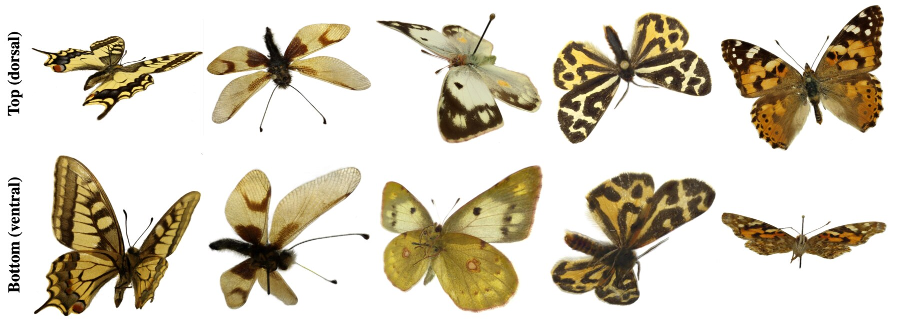

# Practical High-Fidelity Novel-View Synthesis of Mounted Lepidoptera

**WACV 2027** · Kristof Overdulve, Lode Jorissen, Nick Michiels · Digital Future Lab, UHasselt

[](https://kroverdulve.github.io/gsplat-lepidoptera/) [](https://arxiv.org/abs/2606.31679) [](https://superspl.at/scene/095a2469)

**[Project page](https://kroverdulve.github.io/gsplat-lepidoptera/)** · [Paper (arXiv)](https://arxiv.org/abs/2606.31679) · [Dataset (butterfly1)](https://huggingface.co/datasets/KeejOow/butterfly1)

[](https://kroverdulve.github.io/gsplat-lepidoptera/)

*Dorsal (top) and ventral (bottom) renders of five specimens reconstructed with our pipeline; the ventral surface is only ever observed through a mirror.*

## Abstract

> Interactive figures, results and a live 3D viewer are on the **[project page](https://kroverdulve.github.io/gsplat-lepidoptera/)**.

Mounted butterflies are among the most striking objects in natural history collections. However, their beauty is notoriously hard to digitize in 3D: they are small and fragile, with microscopic hairs and vein structures. Capturing them in sufficient detail, therefore, requires a macro lens, which has a very limited Depth of Field (DoF). Moreover, a camera body cannot be maneuvered beneath a pinned specimen to photograph its ventral surface. We introduce an end-to-end pipeline that resolves these challenges, turning such specimens into photorealistic 3D models viewable from every direction. It combines three ingredients: handheld focus stacking for all-in-focus macro capture without a tripod, a non-contact first-surface mirror system that exposes the ventral surface without touching the specimen, and a segmentation-free, mirror-aware 3D Gaussian Splatting extension. We validate the reconstructions and design decisions on nine diverse specimens.

## Citation

```bibtex
@inproceedings{overdulve2027mountedlepidoptera,
      title={Practical High-Fidelity Novel-View Synthesis of Mounted Lepidoptera},
      author={Kristof Overdulve and Lode Jorissen and Nick Michiels},
      booktitle={Proceedings of the IEEE/CVF Winter Conference on Applications of Computer Vision (WACV)},
      year={2027},
      eprint={2606.31679},
      archivePrefix={arXiv},
      url={https://arxiv.org/abs/2606.31679},
}
```

## Funding and acknowledgements

This research was funded by VLAIO under the TETRA program (grant agreement No. HBC.2025.0131).

We gratefully acknowledge imec IDLab for computational resources via the iLab.t infrastructure. This repository builds on [gsplat](https://github.com/nerfstudio-project/gsplat) (Apache-2.0); the trainer extends gsplat's `simple_trainer.py` example with the mirror-aware three-pass compositing described in the paper. See `NOTICE` for which files come from gsplat.

## Repository layout

| Path | Purpose |
| --- | --- |
| `examples/simple_trainer.py` | Mirror-aware 2DGS/3DGS trainer (three-pass compositing, mirror-plane Gaussians, regularizers) |
| `examples/datasets/` | COLMAP dataset loader (images, masks, held-out views, downscaling) |
| `align_images.py` | ECC alignment of handheld focus-stack bursts (before fusion) |
| `detect_mirror.py` | Symmetry-based mirror-plane detection from the dense MVS cloud |
| `run_paper_experiments.py` | Runs one of the paper's experiments on a scene, one model per held-out view |
| `examples/simple_viewer_2dgs.py`, `examples/export_ply_from_ckpt.py` | Interactive viewing and PLY export of trained models |

## Installation

```bash
git clone https://github.com/KrOverdulve/gsplat-lepidoptera.git
cd gsplat-lepidoptera
```

### Docker (recommended)

```bash
docker build -t lepidoptera-gsplat .
docker run --gpus all --ipc=host -it --rm -p 8080:8080 \
    -v /path/to/data:/home/user/code/data \
    -v /path/to/results:/home/user/code/results \
    lepidoptera-gsplat
```

`--ipc=host` gives the data loader workers the shared memory they need (Docker's default of 64 MB is too small). Both folders must be writable by user id 1000 (the trainer caches downscaled images next to the originals). All commands below are run from the repository root (`/home/user/code` inside the container).

### Step by step (what the Dockerfile does)

Tested on Ubuntu 22.04, CUDA 12.8, Python 3.10, an NVIDIA RTX 4090 (24 GB).

```bash
# 1. build tools and PyTorch for CUDA 12.8
pip install --upgrade pip setuptools==78.1.0 pybind11==3.1.0
pip install torch==2.11.0 torchvision==0.26.0 --index-url https://download.pytorch.org/whl/cu128

# 2. gsplat, pinned to the version used for the paper (unmodified upstream)
pip install --no-build-isolation git+https://github.com/nerfstudio-project/gsplat.git@v1.5.3

# 3. remaining dependencies
pip install plyfile==0.8.1 tqdm==4.70.1 numpy==1.26.4 opencv-python==4.11.0.86 open3d==0.20.0
pip install --no-build-isolation -r requirements.txt
```

COLMAP and [hloc](https://github.com/cvg/Hierarchical-Localization) are only needed to calibrate your own captures; the released specimen ships calibrated.

## Data

We release one specimen, `butterfly1` (Specimen 1 in the paper). Download it from [Hugging Face](https://huggingface.co/datasets/KeejOow/butterfly1) and unpack it as `data/butterfly1/` in the repository root:

```
data/butterfly1/undistorted/
    images/          48 focus-stacked captures (one per viewpoint)
    image_masks/     specimen(+reflection) masks of the five held-out views
    sparse/          COLMAP calibration
    dense.ply        dense patch-match-stereo cloud
```

## Quick start: reconstruct butterfly1

**1. Detect the mirror plane** (CPU only, about 20 minutes):

```bash
python detect_mirror.py \
    --input data/butterfly1/undistorted/dense.ply \
    --data_dir data/butterfly1/undistorted/ \
    --output_dir data/butterfly1/undistorted/ \
    --include_reflected
```

This writes `plane_parameters.json` (the plane), `init_cloud.ply` (the camera-side cloud with the reflection folded onto it, which initializes the specimen Gaussians) and `plane_inliers.ply` (the downsampled cloud, green where it supported the plane; open it to check the detection).

**2. Train** our full model on all views at half resolution:

```bash
python examples/simple_trainer.py default \
    --data-dir data/butterfly1/undistorted/ \
    --result-dir results/butterfly1 \
    --data-factor 2 \
    --mirror-param-file data/butterfly1/undistorted/plane_parameters.json \
    --disable-video --disable_viewer --save_ply
```

The defaults are the paper's full model: 2DGS, 30k iterations, seed 42, no densification, alpha-entropy weight 0.1 from iteration 5k, distortion weight 1.0 from iteration 3k. `--data-factor 2` trains on 4055×2704 images; use `--data-factor 4` for a faster, lower-resolution model.

**3. Look at the result** in the browser at `http://localhost:8080`:

```bash
python examples/simple_viewer_2dgs.py --ckpt results/butterfly1/ckpts/ckpt_29999_rank0.pt --port 8080
```

The specimen Gaussians are in `results/butterfly1/ply/point_cloud_29999.ply` (the mirror-plane Gaussians are not exported). A few floaters can remain around the specimen; remove them in a splat editor such as [SuperSplat](https://superspl.at/editor). To export a checkpoint to `ply/point_cloud.ply` afterwards:

```bash
python examples/export_ply_from_ckpt.py --ckpt results/butterfly1/ckpts/ckpt_29999_rank0.pt
```

## The paper's experiments

Each experiment trains one model per held-out view (the five views with a mask), with that view excluded from training:

```bash
python run_paper_experiments.py full             # our full model
python run_paper_experiments.py densify-adc      # ablation: ADC densification
python run_paper_experiments.py densify-none     # ablation: no densification
python run_paper_experiments.py noplane          # ablation: no mirror-plane Gaussians
python run_paper_experiments.py nomirror         # baseline: mirror-unaware 2DGS
python run_paper_experiments.py primitives-3dgs  # baseline: plain 3DGS (ADC)
python run_paper_experiments.py primitives-2dgs  # baseline: plain 2DGS (ADC)
```

This runs on `butterfly1` (step 1 of the quick start must have been run) at `--data_factor 4`, about 30 minutes per model on an RTX 4090, and writes to `results/<experiment>/butterfly1/<view>/`. In each of those folders, `renders/<view>.png` is the held-out render and `stats/val_step29999.json` holds PSNR, SSIM (`data_range` 1.0) and LPIPS (AlexNet, `normalize=True`), full-frame and masked (`*_masked`: render and ground truth composited to white outside the mask).

The paper's tables average over nine specimens (eight for the mirror experiments), of which only `butterfly1` is public, so they cannot be reproduced in full; compare with the Specimen 1 rows of the supplementary tables instead. The ablation's two *reflect-splats* rows were produced with a MirrorGaussian-style variant (duplicate-and-reflect the Gaussians) that is not part of this release, and the macro-defocus comparison additionally needs [DoF-Gaussian](https://dof-gaussian.github.io/) on the raw bursts.

## Your own specimen

**1. Capture.** Handheld bursts of 20-40 frames per viewpoint with a macro lens (we used a Canon EOS R5C), focus sweeping from the nearest to the farthest part of the specimen; 40-90 viewpoints on a hemisphere. For the ventral surface, place two first-surface mirrors under the wings as described in the paper.

**2. Focus stacking.** Align each burst (splits the image sequence into stacks automatically, ECC-aligns the frames):

```bash
python align_images.py --input_dir raw/<scene> --output_dir aligned/<scene>
```

then fuse each aligned stack into one all-in-focus image (we used Helicon Focus' *pyramid* method; any multi-resolution fusion works).

**3. Calibration.** Estimate poses with [hloc](https://github.com/cvg/Hierarchical-Localization) (SuperPoint + SuperGlue), then undistort and run patch-match stereo with COLMAP. This yields `data/<scene>/undistorted/` with `images/`, `sparse/` and the fused `dense.ply`.

**4. Mirror plane and training.** Follow the quick start with your scene's paths; open `plane_inliers.ply` to check the detected plane.

For a specimen captured without mirrors, skip the plane detection and drop `--mirror-param-file`: the trainer then initializes from `dense.ply` and is plain 2DGS without densification (add `--butterfly-densify` for the usual densification, `--model_type 3dgs` for 3DGS).

**5. Held-out views (optional).** To measure quality, paint a mask for each view you want to hold out into `data/<scene>/undistorted/image_masks/` (same file name as the image; white = specimen, including its mirror reflection) and add `--holdout-image-name <view>` to the `simple_trainer.py` call, one training run per held-out view.

## License

Apache License 2.0 (see `LICENSE` and `NOTICE`). Built on [gsplat](https://github.com/nerfstudio-project/gsplat); see `CITATION.bib` for how to cite this work and gsplat.
